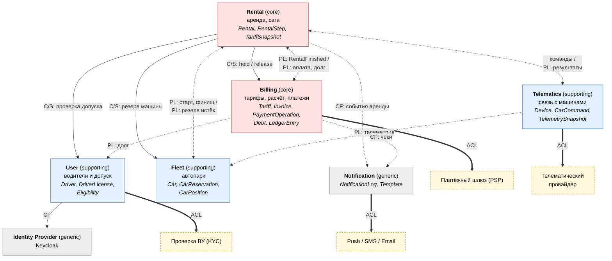

# 1. Карта контекстов

## Диаграмма

[Открыть диаграмму в полном размере](diagrams/01-context-map-1.svg)

**Как читать диаграмму**

- Сплошная стрелка обозначает синхронный вызов (REST), пунктирная обозначает события и команды через Kafka, толстая ведёт к внешней системе.
- Стрелка направлена от того, кто вызывает или публикует, к получателю. У двусторонних пунктирных связей часть подписи до косой черты относится к сообщениям от Rental, часть после черты к сообщениям в Rental.
- Цвет показывает тип контекста: красный для core, синий для supporting, серый для generic, жёлтый с пунктиром для внешних систем.

Подписи на связях обозначают паттерн DDD:

- **C/S** (Customer/Supplier). Во всех трёх синхронных связях Rental выступает заказчиком (downstream), а User, Fleet и Billing поставщиками (upstream).
- **PL** (Published Language). Общий формат событий из [контрактов](03-contracts/README.md). Полный список событий есть в сводной таблице ниже.
- **ACL** (Anti-Corruption Layer). Контекст переводит модель внешней системы в свою.
- **CF** (Conformist). Контекст принимает чужую модель как есть.

## Сводная таблица

| Контекст | Ответственность | Данные (владеет единолично) | Входящие | Исходящие |
|---|---|---|---|---|
| **Rental** | Жизненный цикл аренды, оркестрация саги, таймеры брони | `rentals`, `rental_steps`, `tariff_snapshot`, `outbox`, `inbox` | REST от клиента; события Telematics, Billing, Fleet | REST к User, Fleet, Billing; команды в Telematics; `rental.events` |
| **Billing** | Тарифы, расчёт стоимости, операции с деньгами, долги, бухгалтерский журнал | `tariffs`, `invoices`, `payment_operations`, `debts`, `ledger_entries` | REST hold/release от Rental; `rental.events`; вебхуки PSP | `billing.events`; вызовы PSP |
| **Fleet** | Каталог машин, статус доступности, координаты, поиск рядом | `cars`, `car_reservations`, `car_positions` | REST поиска и резерва; телеметрия; `rental.events` | `fleet.events` |
| **Telematics** | Надёжная доставка команд машине, приём и нормализация телеметрии | `devices`, `car_commands`, `telemetry_last` | Команды из Kafka; колбэки провайдера | `telematics.events`, `telematics.telemetry`; вызовы провайдера |
| **User** | Профиль водителя, проверка прав, допуск к аренде, блокировки за долг | `drivers`, `licenses`, `eligibility_flags` | REST клиента и Rental; `billing.events` | вызовы KYC |
| **Notification** | Доставка уведомлений по шаблонам, дедупликация отправок | `notification_log`, `templates` | `rental.events`, `billing.events` | вызовы push/SMS/email |

Какие именно события ходят по каждой связи:

| От | К | События |
|---|---|---|
| Rental | Telematics | команды `UnlockCar`, `LockCar` |
| Telematics | Rental | `CarUnlocked`, `CarLocked`, `CarCommandFailed` |
| Telematics | Fleet | телеметрия (`telematics.telemetry`) |
| Rental | Fleet | `RentalStarted`, `RentalFinished` |
| Fleet | Rental | `CarReservationLapsed` |
| Rental | Billing | `RentalFinished` |
| Billing | Rental | `PaymentCaptured`, `PaymentFailed`, `DebtSettled` |
| Billing | User | `PaymentFailed`, `DebtSettled` |

## Почему каждый сервис отдельный

### Rental Service
Rental оркестрирует аренду. В нём находятся правила предметной области: когда истекает бронь, можно ли завершить поездку вне зоны, что делать, если машина не открылась. Сервис хранит состояние саги и единственный видит процесс целиком, остальные сервисы отвечают только за свой шаг. Rental выделен отдельно, потому что он меняется чаще остальных (новые сценарии вроде поездки с остановками или передачи машины другу). Смешивать его с деньгами нельзя, там другой темп изменений и требования к аудиту. С автопарком тоже нельзя, там другая модель данных и другая нагрузка. Если Rental упадёт, начатые поездки не прервутся: машина уже открыта, а события подождут в Kafka.

### Billing Service
Billing считает стоимость поездки и проводит деньги через PSP ровно один раз. Здесь хранятся тарифы, счета, операции hold/capture/void/refund, долги и бухгалтерский журнал с двойной записью. Отдельный сервис нужен по трём причинам. Требования к согласованности и аудиту здесь самые строгие: каждая копейка должна сходиться со сверкой PSP. Доступ к платёжным данным должен быть только у одного сервиса и одной команды. Внешний PSP работает нестабильно (вебхуки, таймауты, ретраи), и эти проблемы нужно держать отдельно от логики аренды.

### Fleet Service
Fleet знает, какие машины есть, где они стоят, сколько в них топлива и свободны ли они. Статусом машины владеет только Fleet, поэтому правило «у машины не больше одной аренды» обеспечивается здесь атомарным условным обновлением. Нагрузка у сервиса своя: поиск машин рядом выполняется при каждом открытии карты, и это самый частый запрос в приложении. Ему нужны геоиндекс (PostGIS) и кеш, а масштабировать его надо независимо от аренды. Через Fleet работают и операторы, когда отправляют машину на мойку или в ремонт.

### Telematics Gateway
Telematics Gateway работает как антикоррупционный слой между нашим доменом и IoT-платформой провайдера. Машины бывают без связи (подземный паркинг, разряженный АКБ), команда «открыть» выполняется несколько секунд и подтверждается асинхронно, а у провайдера своя модель данных и свой протокол. Gateway отвечает за ретраи с бэкоффом, таймауты, дедупликацию команд и нормализацию телеметрии. Телеметрия даёт самый большой поток данных в системе (точка от каждой машины раз в 5-10 секунд), и масштабировать его нужно отдельно. При смене провайдера переписывается только этот сервис.

### User Service
User хранит профиль водителя, результат проверки водительского удостоверения (через внешний KYC) и итоговый флаг допуска к аренде. Флаг зависит от проверки прав, блокировок службой безопасности и долга, о котором Billing сообщает событиями. Сервис отдельный, потому что в нём лежат персональные данные (паспорт, ВУ) с особыми требованиями к хранению и доступу (152-ФЗ), а жизненный цикл водителя (регистрация, повторная проверка, бан) не связан с жизненным циклом отдельной аренды. Аутентификацию выполняет Keycloak, User хранит только доменные данные.

### Notification Service
Notification подписан на события аренды и платежей и рассылает push, SMS и email по шаблонам. Он выделен, чтобы сбой или медленная работа провайдеров рассылок не блокировали аренду и списание. Сервис ведёт журнал отправок с дедупликацией по `eventId`, поэтому повторная доставка события из Kafka не приводит к двойному SMS. Это типичный generic-контекст, его можно заменить готовым решением без изменений в остальных сервисах.

## Почему не монолит

В задании есть проверка: можно ли сделать всё одним сервисом с одной базой. В нашем случае нельзя. Даже в монолите аренда остаётся распределённым процессом: машина является отдельным устройством, отвечает асинхронно и бывает офлайн, деньги проходят через внешний PSP, с которым у нас нет общей транзакции, а шаги разнесены во времени на десятки минут. Поэтому сага, компенсации и идемпотентность нужны в любом случае. Разделение на сервисы вдобавок позволяет масштабировать поиск машин и приём телеметрии отдельно от денег, держать персональные и платёжные данные в изолированных контурах и не останавливать поездки при сбое рассылок или платёжного шлюза.
