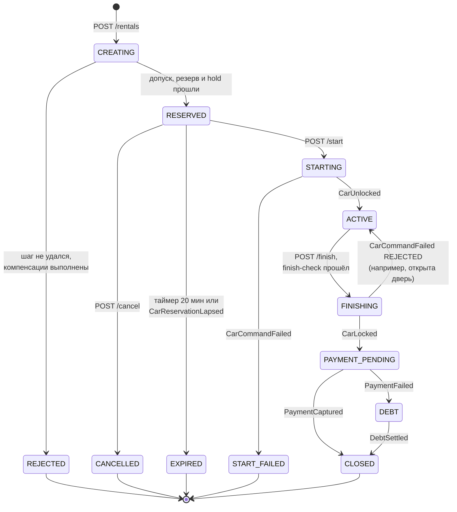
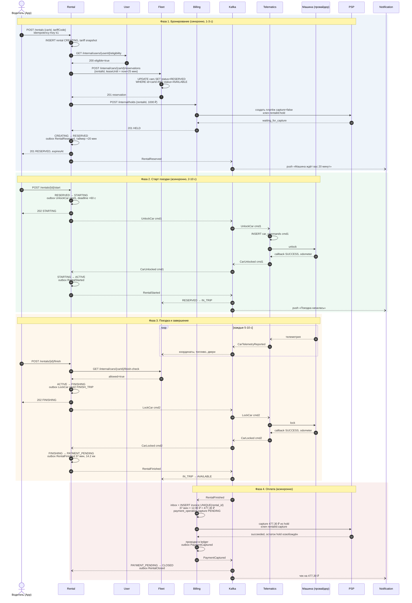
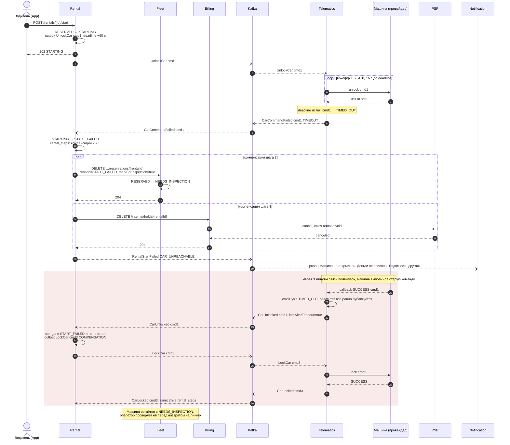
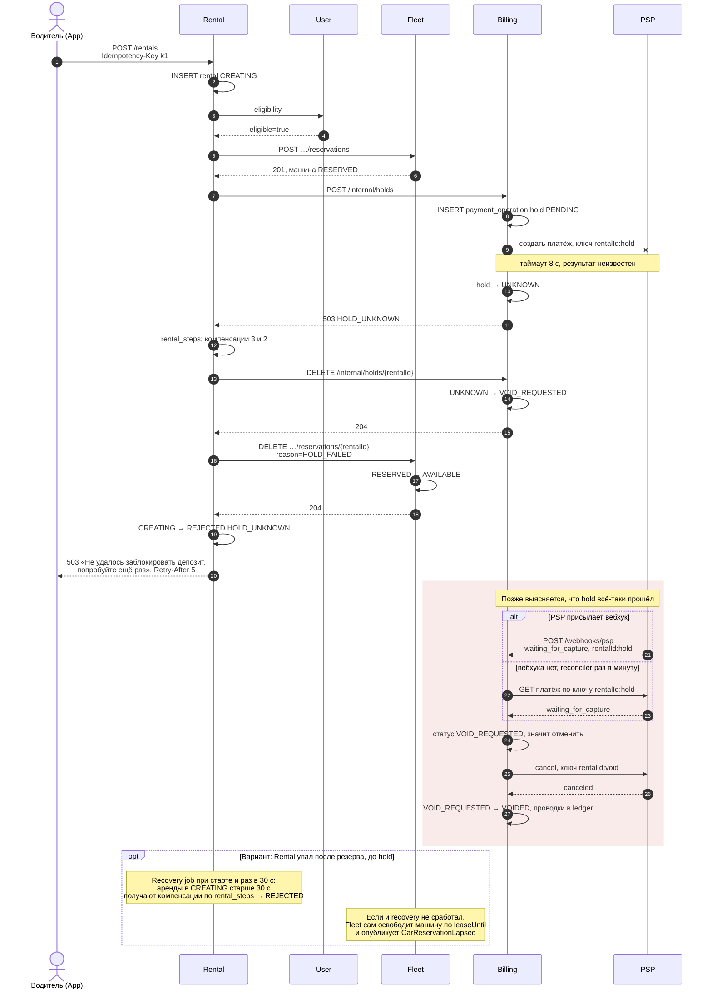
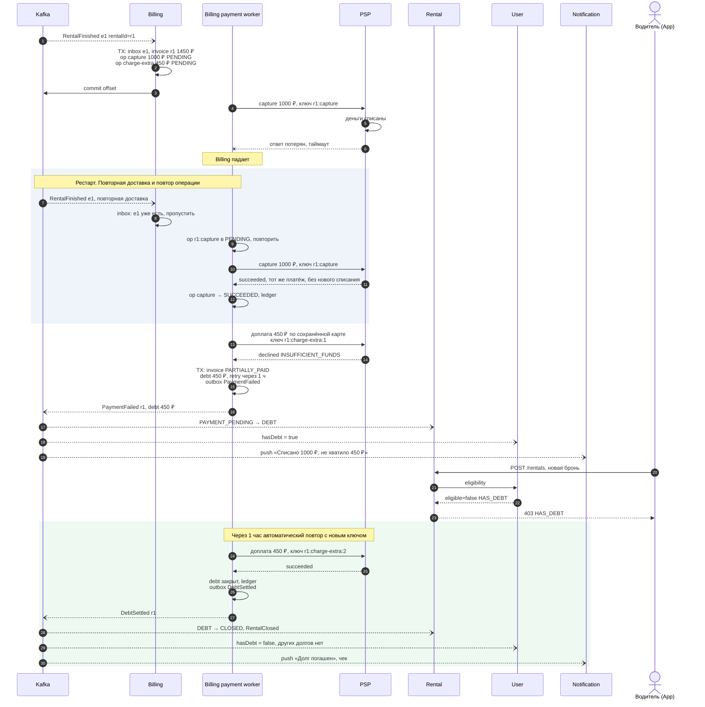

# 4. Главный процесс: аренда машины

Аренда реализована как сага с оркестратором в Rental Service ([ADR-0001](05-adr/0001-saga-orchestration.md)). Она проходит четыре фазы: бронирование (синхронно, пока пользователь ждёт ответа), старт (асинхронная команда машине), поездка и завершение (тоже асинхронная команда машине) и оплата (асинхронно в Billing).

Диаграммы последовательностей в этом файле широкие, на странице они уменьшаются. Под каждой есть ссылка на SVG в полном размере.

## Состояния аренды

Каждый переход выполняется одной локальной транзакцией в Rental DB:
`UPDATE rentals SET status=:to, version=version+1 WHERE id=:id AND status=:from AND version=:v`, плюс запись в `rental_steps` и, если нужно, в `outbox`. Если `UPDATE` затронул 0 строк, значит другой переход уже случился (например, таймер истечения и `POST /start` пришли одновременно). Такое событие игнорируется или получает ответ `409`.

Ещё один инвариант Rental: у пользователя не больше одной активной аренды. Его обеспечивает частичный уникальный индекс `UNIQUE(user_id) WHERE status IN ('CREATING','RESERVED','STARTING','ACTIVE','FINISHING')`.

## Шаги саги и компенсации

| # | Шаг | Участник | Тип | Компенсация | Если компенсация не прошла |
|---|---|---|---|---|---|
| 1 | Проверить допуск | User | REST, чтение | не нужна | |
| 2 | Зарезервировать машину | Fleet | REST | `DELETE …/reservations/{rentalId}` | ретраи из `rental_steps`, на крайний случай lease во Fleet |
| 3 | Поставить hold | Billing → PSP | REST | `DELETE /internal/holds/{rentalId}` (void) | ретраи, на крайний случай reconciler в Billing и автоматическое снятие hold банком примерно через 7 дней |
| 4 | Открыть машину | Telematics → машина | Kafka-команда | `LockCar(purpose=COMPENSATION)` | ретраи команды, алерт оператору |
| 5 | Закрыть машину | Telematics → машина | Kafka-команда | нет, только повтор вперёд | повтор каждые 2 мин до 30 мин, затем инцидент |
| 6 | Рассчитать и списать | Billing → PSP | Kafka-событие | нет, только движение вперёд (долг и повторы списания) | долг, блокировка новых аренд |

Шаги 5 и 6 поворотные (pivot): если человек уже проехал на машине, поездку не отменить. С этого места сага идёт только вперёд, а сбои обрабатываются повторами и долгом, без отката.

---

## Успешный сценарий

[Открыть диаграмму в полном размере](diagrams/04-main-process-2.svg)

Что важно в успешном сценарии:
- Синхронно выполняется только фаза 1. Пользователь получает ответ «забронировано» только после того, как машина действительно закреплена за ним и депозит заблокирован.
- `finishedAt` берётся из подтверждения машины, а не из времени нажатия кнопки. Так Billing считает фактическое время, и повторный `POST /finish` ничего не меняет.
- Fleet освобождает машину сразу после `RentalFinished`, не дожидаясь оплаты. Физическая доступность машины не зависит от денег.
- Если стоимость больше hold (например, 1450 ₽ при hold 1000 ₽), Billing делает `capture` на 1000 ₽ и доплату 450 ₽ по сохранённой карте с ключом `rentalId:charge-extra`. Что происходит, если доплата не проходит, показывает сценарий сбоя 3.

---

## Сценарий сбоя 1. Машина не открылась

**Что ломается:** телематический блок не отвечает. Машина стоит в подземном паркинге без связи или у неё разряжен АКБ. Через 3 минуты связь появляется, и машина всё-таки выполняет команду, которая уже считается просроченной.

**Чем опасно:** пользователь стоит у закрытой машины, а депозит заморожен. Кроме того, машина может открыться, когда аренды уже нет, и остаться открытой без присмотра.

[Открыть диаграмму в полном размере](diagrams/04-main-process-3.svg)

**Как система компенсирует:**
1. У команды в Telematics есть явный дедлайн, поэтому пользователь не ждёт бесконечно: через 60 секунд он получает понятный ответ.
2. Rental выполняет компенсации шагов 2 и 3 параллельно. Обе идемпотентны, и при сбое (например, если Billing недоступен) их повторяет фоновый обработчик `rental_steps` с бэкоффом.
3. Машина уходит в `NEEDS_INSPECTION`, а не в `AVAILABLE`, иначе следующий пользователь наткнётся на ту же проблему.
4. Если машина открылась с опозданием, Telematics не выбрасывает поздний результат, а публикует его с флагом `lateAfterTimeout`. Rental видит, что аренда уже в `START_FAILED`, и отправляет компенсирующую команду `LockCar`, поэтому машина не остаётся открытой.
5. Команды `UnlockCar` и `LockCar` для одной машины не меняются местами, потому что ключом партиции в `telematics.commands` служит `carId`.

---

## Сценарий сбоя 2. Платёжный шлюз завис во время бронирования

**Что ломается:** машина уже зарезервирована, Billing отправил в PSP запрос на hold, а PSP не ответил за 8 секунд. Результат неизвестен: деньги могли заблокироваться, а могли и нет. В более сложном варианте падает сам Rental между шагами.

**Чем опасно:** если просто вернуть ошибку, машина останется зарезервированной без аренды, а на карте может остаться hold. Если повторить hold с новым ключом, можно заблокировать деньги дважды.

[Открыть диаграмму в полном размере](diagrams/04-main-process-4.svg)

**Как система компенсирует:**
1. Неизвестный результат обрабатывается как неудача с отложенной отменой. Rental компенсирует всё, что успел сделать, и отвечает пользователю `503`. Повторить hold с новым ключом Billing не может, потому что ключ детерминированный: `rentalId:hold`.
2. Отмена может прийти раньше подтверждения. Для hold в статусе `UNKNOWN` запрос `DELETE /holds` ставит метку `VOID_REQUESTED`. Когда PSP сообщит, что hold прошёл (через вебхук или при опросе reconciler'ом), Billing сразу его отменит.
3. Компенсации идут в обратном порядке (сначала hold, потом машина) и записываются в `rental_steps` до вызова. Если Rental упадёт посреди компенсаций, recovery job продолжит с места остановки.
4. Подстраховка есть на трёх уровнях: recovery job в Rental, lease во Fleet и автоматическое снятие hold банком.
5. Повтор с тем же `Idempotency-Key k1` разрешён: ответы `5xx` не кешируются, а прошлая попытка уже в терминальном `REJECTED`, поэтому создаётся новая аренда.

---

## Сценарий сбоя 3. Оплата после поездки: таймаут, падение Billing и нехватка денег

**Что ломается:** поездка стоила 1450 ₽, hold был 1000 ₽. Billing отправляет `capture` в PSP, PSP списывает деньги, но ответ теряется, и Billing падает. После рестарта Kafka доставляет `RentalFinished` повторно. Затем доплата 450 ₽ отклоняется, потому что на карте не хватает денег.

**Чем опасно:** если просто повторять запрос, пользователь заплатит дважды. Если просто записать ошибку, компания потеряет 450 ₽. Откатить поездку при этом нельзя.

[Открыть диаграмму в полном размере](diagrams/04-main-process-5.svg)

**Как система компенсирует:**
1. Для двух разных причин повтора используются разные ключи. Если результат неизвестен (таймаут), запрос повторяется с тем же ключом (`r1:capture`), и PSP вернёт уже проведённый платёж. Если пришёл окончательный отказ (declined), следующая попытка считается новой операцией с новым ключом (`r1:charge-extra:2`). Если перепутать эти случаи, получится либо двойное списание, либо ошибка, которая будет повторяться бесконечно.
2. Намерение записывается раньше действия: операции `PENDING` сохраняются в той же транзакции, что и счёт, ещё до вызова PSP. После рестарта payment worker находит незавершённые операции и доводит их до конца.
3. Повторная доставка события безопасна благодаря inbox по `eventId` и `UNIQUE(rental_id)` на счёте.
4. Компенсация здесь идёт вперёд, а не назад. Поездку отменить нельзя, поэтому система открывает долг, блокирует новые аренды через User и повторяет списание по расписанию (через 1 ч, 6 ч, 24 ч, затем раз в сутки). Пользователь может погасить долг сам через `POST /me/debts/{id}/pay`.
5. Раз в сутки reconciler сверяет `payment_operations` с реестром PSP. Если расхождение не исправляется автоматически, создаётся задача финансовому оператору.

---

## Другие сбои

| Сбой | Поведение системы |
|---|---|
| Kafka недоступна | Сервисы продолжают принимать запросы, события копятся в `outbox`. Relay публикует их после восстановления. Новые старты и завершения задерживаются, но не теряются. |
| Rental упал во время поездки | Поездка продолжается: машина открыта, тарификация считается по времени из `CarLocked`. Кнопка «Завершить» временно не работает, приложение показывает статус. |
| Двойное нажатие «Завершить» | Второй вызов видит `FINISHING` и возвращает `202` с текущим состоянием. Новой команды нет. |
| `LockCar` не исполнился (машина офлайн при завершении) | Rental повторяет команду каждые 2 мин в течение 30 мин, затем создаёт инцидент для оператора. Время пользователю считается до нажатия «Завершить», потому что задержка не по его вине. |
| `LockCar` отклонён (дверь открыта) | `FINISHING → ACTIVE`, push «Закройте дверь». Тарификация продолжается. |
| Пользователь не пришёл к машине | Через 20 минут срабатывает таймер Rental: `RESERVED → EXPIRED`, затем компенсации шагов 2 и 3. Если таймер не сработал, Fleet по `leaseUntil` публикует `CarReservationLapsed`. |
| Notification или SMS-шлюз недоступен | Сага от этого не зависит. Уведомления доставляются позже, дубли отсекаются по `eventId`. |
| Ядовитое сообщение (не парсится) | После 5 попыток уходит в `*.DLT`, срабатывает алерт, партиция не блокируется. |
