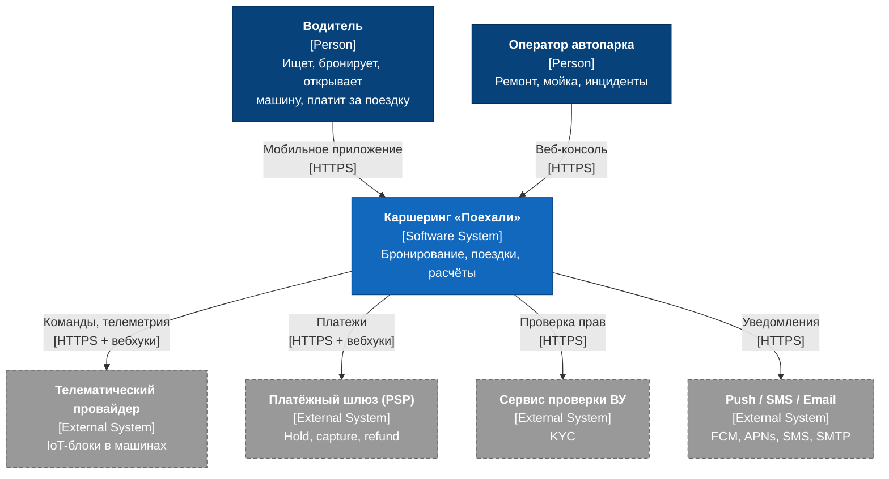
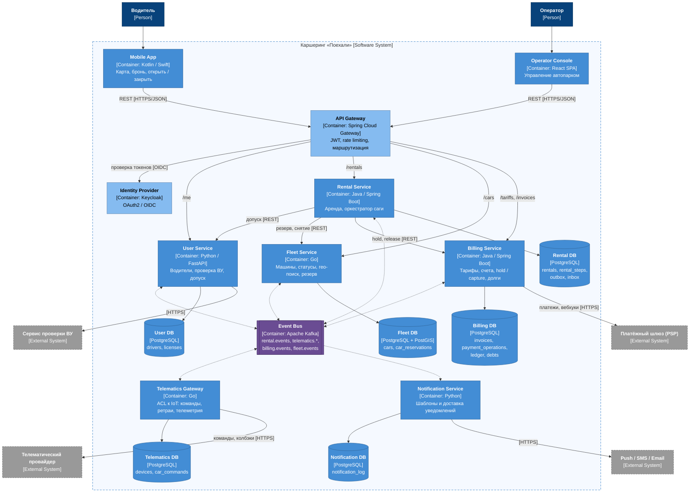

# 2. C4, уровень Container

Диаграммы нарисованы в нотации C4 (человек, контейнер с технологией, хранилище, внешняя система, граница системы, протокол на связях) через Mermaid `flowchart`. 

**Легенда**

- тёмно-синий: человек;
- синий: наш контейнер, цилиндр обозначает базу данных;
- голубой: инфраструктурный контейнер (API Gateway, Keycloak);
- фиолетовый: брокер Kafka;
- серый с пунктирной рамкой: внешняя система;
- сплошная стрелка: синхронный вызов, пунктирная: обмен через Kafka.

## Context (уровень 1, для ориентира)

## Container (уровень 2)

[Открыть диаграмму в полном размере](diagrams/02-c4-container-2.svg)

Подписей на связях с Kafka нет, чтобы схема помещалась в ширину страницы. Кто что публикует и читает, показано в таблице [Топики Kafka](#топики-kafka).

## Пояснения к контейнерам

| Контейнер | Ключевые технические решения |
|---|---|
| **API Gateway** | Единая точка входа. Проверяет JWT и пробрасывает `X-User-Id`. Ограничивает частоту запросов: на `POST /rentals` не больше 5 в минуту на пользователя. Заголовок `Idempotency-Key` сам не обрабатывает, только пропускает дальше. |
| **Rental Service** | Состояние саги хранится в `rentals` (state machine) и `rental_steps` (журнал шагов). События уходят через transactional outbox ([ADR-0002](05-adr/0002-transactional-outbox.md)). Таймеры брони реализованы через таблицу `scheduled_jobs` с поллингом (`SELECT … FOR UPDATE SKIP LOCKED`). |
| **Fleet Service** | Статус машины меняется только условным `UPDATE … WHERE status='AVAILABLE'` ([ADR-0004](05-adr/0004-car-reservation-exclusivity.md)). Поиск машин рядом идёт через индекс GiST по `geography(Point)`. Последние координаты кешируются в памяти с TTL 5 секунд. |
| **Telematics Gateway** | Читает `telematics.commands`, ведёт журнал `car_commands` с уникальным `commandId`, повторяет команды с экспоненциальным бэкоффом, у каждой команды есть дедлайн. Телеметрию от провайдера нормализует и пишет в `telematics.telemetry`. |
| **Billing Service** | Ключ идемпотентности для PSP строится как `{rentalId}:{operation}`. У таблицы `invoices` есть `UNIQUE(rental_id)`. Фоновый reconciler сверяет операции в статусе `UNKNOWN` с PSP. В журнал проводок записи только добавляются (append-only). |
| **Kafka** | 3 брокера, `replication.factor=3`, `min.insync.replicas=2`, продюсеры с `acks=all` и `enable.idempotence=true`. Ключи партиционирования: `rentalId` для аренд и платежей, `carId` для команд и телеметрии ([ADR-0003](05-adr/0003-kafka-as-event-bus.md)). |
| **Базы данных** | Database-per-service: ни один сервис не читает чужую БД. На этапе реализации это может быть один инстанс PostgreSQL с отдельной схемой и отдельным пользователем на каждый сервис. |

## Топики Kafka

| Топик | Ключ | Продюсер | Консьюмеры | Retention |
|---|---|---|---|---|
| `rental.events` | `rentalId` | Rental | Fleet, Billing, Notification | 7 дней |
| `telematics.commands` | `carId` | Rental | Telematics | 1 день |
| `telematics.events` | `carId` | Telematics | Rental | 7 дней |
| `telematics.telemetry` | `carId` | Telematics | Fleet | 1 день, `compact` выключен |
| `billing.events` | `rentalId` | Billing | Rental, User, Notification | 30 дней |
| `fleet.events` | `carId` | Fleet | Rental | 7 дней |
| `*.DLT` | как в исходном топике | любой консьюмер | ручной разбор | 14 дней |
